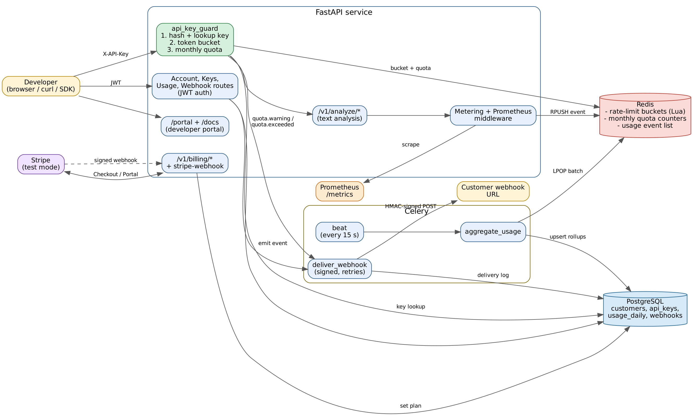

# BE-03 · API Platform with Rate Limiting, Billing & Developer Portal

An API **sold as a product**: developers sign up, create API keys, get metered and rate-limited
per plan, pay through Stripe (test mode), receive signed webhooks, and use an interactive docs portal.
The sample product is a **Text Analysis API** (sentiment, stats, keywords).



## Features (mapped to the milestones)

| # | Milestone | Where |
|---|-----------|-------|
| 1 | Sample API (text analysis) | `app/analysis.py`, `app/routers/analyze.py` |
| 2 | API key create / hash / revoke | `app/security.py`, `app/routers/keys.py` |
| 3 | Redis rate limiting (token bucket, atomic Lua) | `app/ratelimit.py`, `app/deps.py` |
| 4 | Metering + Celery aggregation | `app/metering.py`, `app/tasks.py` |
| 5 | Plans (free/pro), quotas, Stripe test billing | `app/plans.py`, `app/routers/billing.py` |
| 6 | Webhooks + client SDKs | `app/webhooks.py`, `scripts/generate_sdks.sh` |
| 7 | Prometheus metrics + docs portal | `app/metrics.py`, `/metrics`, `/docs`, `/portal` |

| Plan | Sustained rate | Burst | Monthly quota | Price |
|------|---------------|-------|---------------|-------|
| free | 0.5 req/s | 10 | 1,000 | $0 |
| pro  | 20 req/s | 100 | 100,000 | $29 (set in Stripe) |

## Setup (laptop)

### 1. Install prerequisites
* **Git**, **Python 3.11+**, **Docker Desktop** (includes Docker Compose) — https://www.docker.com/products/docker-desktop
* (Optional, for Stripe) **Stripe CLI** — https://docs.stripe.com/stripe-cli

### 2. Get the code
```bash
git clone <your-repo-url>
cd <repo>/BE-03
cp .env.example .env        # Windows PowerShell: copy .env.example .env
```

### 3. Run everything with Docker (recommended)
```bash
docker compose up --build
```
This starts Postgres, Redis, the API, a Celery worker, Celery beat and Prometheus.

| URL | What |
|-----|------|
| http://localhost:8000/portal | Developer portal (sign up, keys, try it, usage) |
| http://localhost:8000/docs | Interactive Swagger docs |
| http://localhost:8000/metrics | Prometheus metrics |
| http://localhost:9090 | Prometheus UI |

### 4. Try it in 60 seconds
1. Open `/portal`, sign up, click **Create key**, copy the key.
2. Click **Analyze sentiment** a few times. After ~15 s the usage table fills (Celery job).
3. Click it ~15 times quickly → you will see `429` and `Retry-After`.

Or with curl:
```bash
curl -X POST http://localhost:8000/v1/analyze/sentiment \
  -H "X-API-Key: apk_YOUR_KEY" -H "Content-Type: application/json" \
  -d '{"text":"I absolutely loved this film"}'
```

### 5. Stripe test mode (billing)
1. Create a free Stripe account → toggle **Test mode**.
2. Dashboard → Product catalog → create product **Pro** with a recurring $29/month price; copy the `price_...` id.
3. Dashboard → Developers → API keys → copy the **secret key** `sk_test_...`.
4. Forward webhooks locally: `stripe listen --forward-to localhost:8000/v1/billing/stripe-webhook` → copy the printed `whsec_...`.
5. Put all three in `.env` (`STRIPE_SECRET_KEY`, `STRIPE_PRO_PRICE_ID`, `STRIPE_WEBHOOK_SECRET`) and `docker compose up -d --force-recreate`.
6. Portal → **Upgrade to Pro** → pay with card `4242 4242 4242 4242`, any future date, any CVC. The webhook flips the plan to `pro`.

### 6. Run without Docker (tests only)
```bash
python -m venv .venv && source .venv/bin/activate   # Windows: .venv\Scripts\activate
pip install -r requirements.txt
python -m pytest -q            # uses SQLite + fakeredis, no services needed
```

### 7. Generate client SDKs
With the API running: `./scripts/generate_sdks.sh` → `sdks/python` and `sdks/typescript-fetch`.

## Test & performance results (measured)

* **Unit/integration tests:** `24 passed` (`python -m pytest -q`): auth, key hashing/revocation, token bucket,
  429 headers, per-key isolation, quota + upgrade, metering/aggregation idempotence, webhook signing/filtering/retry,
  Stripe webhook upgrade/downgrade/bad signature, Prometheus output, OpenAPI.
* **End-to-end with real Redis** (single machine, SQLite, one uvicorn worker, 20 client threads on the same box):
  * Free plan, 200 requests → **11 × 200, 189 × 429** (10 burst + 1 refilled token) — limiter correct under concurrency.
  * Pro plan, 300 requests → **162 × 200, 138 × 429** (≈100 burst + 20/s × 3.3 s).
  * All 200 metered events aggregated into `usage_daily` correctly (`requests=200, rate_limited=189`).
  * Throughput ≈ 85–90 req/s with p50 ≈ 200 ms **under 20-way client concurrency on a laptop-class box** — this is a
    sandbox figure, not a capacity claim. Re-run `scripts/load_test.py` on your machine/Postgres for your own numbers.
* **Sentiment accuracy:** not claimed. Run `scripts/eval_sentiment.py` on IMDB/Sentiment140 and paste your result here:
  `accuracy = ____ on ____ samples`.

## Design decisions & trade-offs
* **Token bucket in Lua** → atomic across many API workers; gives burst + sustained rate.
* **Keys stored as HMAC-SHA256** (keyed with a server pepper), shown once. Keys are 256-bit random so a fast hash is safe and keeps lookups cheap.
* **Metering off the hot path:** request only does one Redis `RPUSH`; Celery batches into Postgres. Quota uses a separate live Redis counter.
* **Plan changes only come from signature-verified Stripe webhooks.**
* **Known limitations / next steps:** Alembic migrations (uses `create_all`), cache key lookups in Redis, Redis Cluster
  for scale, per-endpoint cost weights, Stripe usage-based (metered) billing, a stronger sentiment model, rate-limit
  on `/auth/*`, email verification, Grafana dashboards.

## Project layout
```
BE-03/
  app/            FastAPI app (routers/, models, plans, ratelimit, metering, tasks, webhooks, metrics, static/portal.html)
  tests/          pytest suite
  scripts/        load_test.py, eval_sentiment.py, generate_sdks.sh
  docs/           architecture.png/.dot, EXPLANATION.md, VIDEO_SCRIPT.md
  docker-compose.yml  Dockerfile  prometheus.yml  .env.example
```
